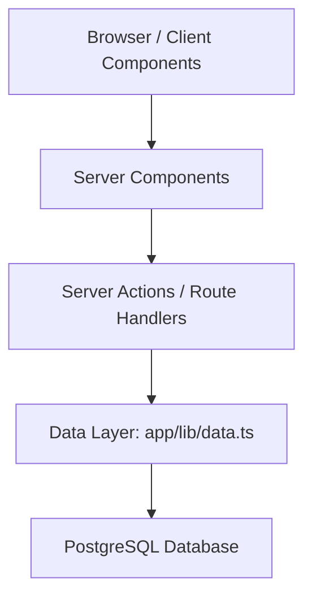

# Next.js Dashboard — Architecture and Lifecycle

## T2.1 — Application Architecture

The application is built with Next.js App Router. It uses a layered architecture to separate the user interface, server-side processing, data access, and database storage.

### Architecture Diagram

### Layer Responsibilities

**1. Browser / Client Components**

The browser displays the dashboard interface and allows users to interact with forms, buttons, and navigation. Client Components handle interactive behavior that runs in the user's browser.

**2. Server Components**

Server Components prepare pages and render server-side content. They can retrieve data securely without exposing database credentials to the browser.

**3. Server Actions and Route Handlers**

Server Actions process operations such as creating, updating, and deleting records. Route Handlers provide server-side endpoints for HTTP requests.

**4. Data Layer** `app/lib/data.ts`**)**

The data layer contains functions that retrieve information from the database. It keeps database queries separate from the user interface and makes data access easier to maintain.

**5. PostgreSQL Database**

The database stores application information, including users, customers, and invoices. It provides persistent storage so records remain available between sessions.

## T2.3 — Application Environments

| Environment | URL | Database | Environment variables | Users |

|---|---|---|---|---|

| Local | [http://localhost:3000](http://localhost:3000) | Neon PostgreSQL (development database should be separate) | POSTGRES_URL, AUTH_SECRET | Developer |

| Preview | Vercel-generated preview URL | Separate Neon preview database recommended | POSTGRES_URL, AUTH_SECRET | Developer, reviewers, classmates |

| Production | [https://nextjs-dashboard-orpin-six-n8g1inxz5d.vercel.app/](https://nextjs-dashboard-orpin-six-n8g1inxz5d.vercel.app/) | Neon PostgreSQL (production) | POSTGRES_URL, AUTH_SECRET | Authorized application users |

### Environment Management

Local development runs on my laptop using `pnpm dev`.

Preview deployments allow changes to be tested before they are merged into the main branch. Vercel can generate preview deployments for pull requests.

Production is the live application deployed on Vercel.

Environment variables contain sensitive configuration and must not be committed to GitHub. Each environment should use separate database credentials and an appropriate authentication secret.

The preview environment and separate database configurations must be verified before they are considered fully configured.

## T2.4 — Database Migration Process

Database schema changes are maintained as SQL migration files inside `supabase/migrations/`.

A schema change follows these steps:

1. Create a new numbered SQL migration file.

2. Review the SQL commands and test them on a development database.

3. Commit the migration file to GitHub.

4. Open a pull request for review.

5. Apply the approved migration to the production database using a controlled migration process.

6. Verify that the production application works correctly.

Our application uses Neon PostgreSQL. The `supabase/migrations/` directory is used to organize SQL migration files as required by the assignment; it does not mean the database is hosted on Supabase.

Migration files should be tested before production deployment. A database backup or recovery point should be available before risky schema changes.

## T2.6 — Application Lifecycle

### Major Next.js Updates

When a major Next.js version is released, I will read the release notes and migration guide. I will update dependencies on a separate Git branch, run tests and the production build, and verify the application on a preview deployment before merging.

### Database Backups

The PostgreSQL database is hosted on Neon. I will review the provider's backup and recovery features, ensure appropriate recovery options are enabled, and periodically test recovery.

Before making major database changes, I will create a suitable backup or recovery point.

### Logging and Monitoring

I will use Vercel deployment and runtime logs to investigate application errors.

I will monitor deployment failures, authentication problems, database connection errors, and application availability.

Sensitive information such as passwords, authentication tokens, and database connection strings must never appear in logs.

### Retiring the Application

If the application is no longer needed, I will first inform its users and arrange an appropriate data export or retention process.

I will then disable access, remove the Vercel deployment, revoke unused credentials, and delete database resources only after confirming that important data has been preserved or can be lawfully deleted.

Finally, I will archive the GitHub repository and document the retirement decision.

## Where New Features Belong

- UI pages and layouts: `app/`

- Interactive browser components: `app/ui/`

- Server-side mutations: `app/lib/actions.ts`

- Database read functions: `app/lib/data.ts`

- Shared types: `app/lib/definitions.ts`

- Database schema changes: `supabase/migrations/`

- Architecture decisions: `docs/adr/`

This structure helps developers identify where new features should be implemented and maintained.

